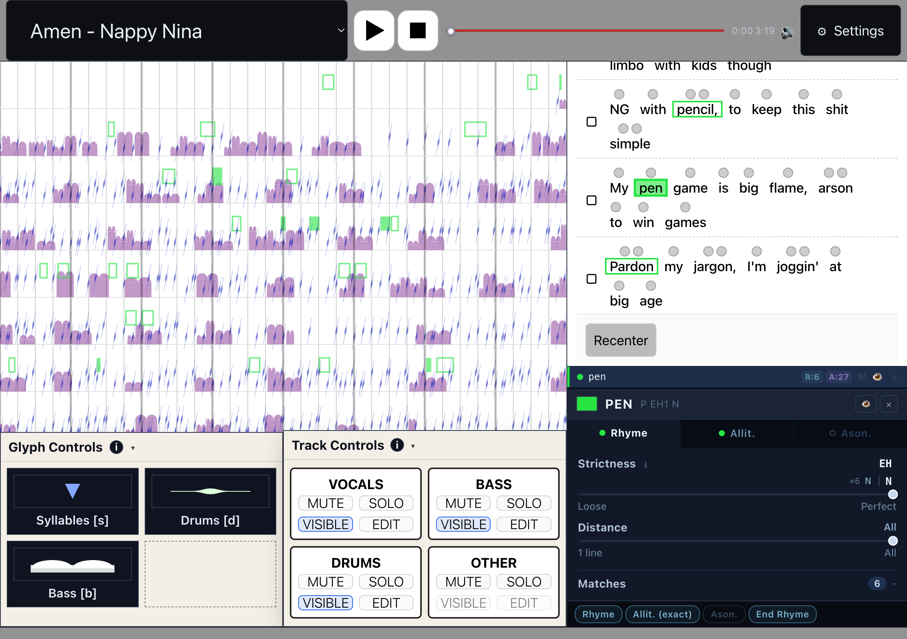

# RapTapestry

An interactive, browser-based visualization of rap vocals against their beat. It lays a song out as a **tapestry**: rows of bars, left to right, with every syllable, word, and line of the lyrics placed at the exact moment it is rasped, sung, or spoken, alongside drum hits and bass notes. Clicking a word or line asks a phonetic question ("what else in this song rhymes with this?") and the answer lights up across the tapestry and the lyric sheet while the song plays.



**In one sentence:** the app loads pre-computed transcriptions (word- and phone-level lyric alignment, beats, drum hits, bass notes) plus four audio stems for a song, builds a beat grid from the detected tempo, and renders every event onto that grid as an SVG glyph, so that a listener can select any word, line, or run of syllables and see all phonetically similar material found by a formant- and feature-based phoneme similarity engine, tuned live by a set of strictness, tolerance, and search-distance parameters.

## Intended use

RapTapestry is a listening and analysis tool, not an editor. It is meant for close reading of a verse: hearing a rhyme scheme while seeing it, comparing how an artist's internal rhymes, alliteration, and assonance line up with the drums, and experimenting with how strict "rhyme" has to be before a pattern disappears. Four songs ship with the repository and are selectable in the header.

## Running it

```bash
npm install
npm run dev        # Vite dev server
npm run build      # production build to dist/
npm test           # vitest: phoneme similarity, coda alignment, playhead index
```

Open the URL Vite prints, pick a song, press play.

## Where this repository stops

**This app does no audio or lyric analysis of its own.** Everything it draws is read from files under [`public/data/<Song>/`](public/data). The single entry point that defines that boundary is [`src/utils/fetchSongData.js`](src/utils/fetchSongData.js). Producing those files is a separate, upstream pipeline that is **not** included here. Concretely, the following happen before this repo is involved:

- Stem separation into vocals, drums, bass, and other.
- Lyric transcription and forced alignment to word start and end times.
- Grapheme-to-phoneme conversion into ARPAbet, including syllable counts and per-word vowel centroid values.
- Beat and downbeat tracking, tempo estimation, and drum hit detection with high, mid, and low classification.
- Bass note transcription into pitch classes with timing and loudness.

To add a song, produce the files below with whatever tools you prefer, drop them into a new folder, and add an `<option>` for it in [`src/App.jsx`](src/App.jsx).

## How the data works

Each song folder holds three JSON files and an `audio/` folder. Only the lyric transcription is required. Missing drum or bass files are skipped with a console warning.

| File | Shape |
| --- | --- |
| `lyric-transcription.json` | `{ text, lines: [{ start, end, text, words: [{ start, end, text, phones: ["AY1", ...], nSyllables, centroid: [0..1, ...] }] }] }` |
| `drum-transcription.json` | `{ estimated_bpm, downbeats: [s, ...], beats: [s, ...], drum_hits: [{ time, category: "high" \| "mid" \| "low" }] }` |
| `bass-transcription.json` | `[{ start_time, end_time, pitch_class: 0..11, mean_rms }]` |
| `audio/<Song>_Vocals.*`, `_Drums.*`, `_Bass.*`, `_Other.*` | One stem each, `mp3` or `wav` (also probes `m4a` and `ogg`) |

Notes on the fields the app depends on:

- `phones` is a list of candidate ARPAbet pronunciations. The first entry drives glyph placement. All entries contribute vowel candidates to syllable matching.
- `centroid` is a per-syllable value in `[0, 1]` that sets a syllable glyph's vertical position within its row.
- `beats` plus `estimated_bpm` build the grid. Gaps in the detected beats are back-filled at the estimated tempo, and rows are cut every eight bars of 4/4 (see [`src/utils/computeLayout.js`](src/utils/computeLayout.js)).
- Song duration comes from the vocals stem's metadata, falling back to the first stem found.

## How it works

1. **Load.** `fetchSongData` fetches the three JSON files and probes for each stem in parallel. Every stem becomes its own `<audio>` element so they can be mixed, muted, and soloed independently while staying in sync.
2. **Lay out.** `computeLayout` turns beats and tempo into a time-to-pixel mapping: row boundaries, beat columns, and row height (fit to the viewport or a fixed pixel height).
3. **Render.** The tapestry is five stacked SVG layers in z-order: bass, lines, words, syllables, then drums and grids. Each layer defines one shared `<symbol>` and mask, so each glyph is a single `<use>`. A PixiJS canvas on top draws the playhead every frame from a subscription, with no React re-render.
4. **Query.** Selecting an anchor word, line, or syllable range runs it against every other candidate in the song through the phoneme similarity engine. Matches update through per-item subscriptions so only affected glyphs and lyric blocks re-render.

### The phonetic engine

[`src/utils/phonemeSimilarity.js`](src/utils/phonemeSimilarity.js) scores ARPAbet phones rather than spelling:

- **Vowels** are placed by mean F1 and F2 formant frequencies (Hillenbrand et al. 1995), converted to the Bark scale, and compared by normalized Euclidean distance.
- **Consonants** are compared as distinctive feature vectors: place, manner, voicing, nasality, laterality, sibilancy.
- Each word is decomposed into onset, nucleus, and coda around its last vowel. **Rhyme** requires the nucleus similarity and the coda similarity to each pass an independent gate. **Assonance** looks at the primary stressed vowel only. **Consonance** looks at the coda only. **Alliteration** looks at the onset only.
- Coda clusters of unequal length are aligned with a small order-preserving dynamic program and a coverage penalty. Open versus closed syllables get partial credit.

### Interactions

| Action | Where | Effect |
| --- | --- | --- |
| Click | Lyric word, word glyph, line glyph, syllable glyph | Seek playback to that moment |
| Cmd/Ctrl + click | Same | Create an anchor, or adopt the item into the most recent one |
| Alt + click | Same | Remove the most recent anchor for that item |
| Click, then click again | Syllable glyphs or syllable dots in the lyric sheet | Select a range of syllables as one vowel sequence query |
| `S`, `D`, `B` | Anywhere | Randomize the syllable glyph, drum glyph, or bass divider shape |
| Channel strips | Bottom right of tapestry | Per-stem volume, mute, and solo; drums, bass, and vocals have their own appearance panels |
| Header gear | Top right | Global layout, row height mode, and background color |

## Parameters

Query parameters live in the active query panel and can be set globally or overridden per anchor. Visual parameters live in the channel strip panels and the global settings overlay. All state is in [`src/contexts/ParamsContext.jsx`](src/contexts/ParamsContext.jsx).

| Parameter | Range | Meaning |
| --- | --- | --- |
| Rhyme strictness | 0 to 1 | Threshold the last vowel must clear |
| Coda tolerance | 0 to 1 | Coda threshold as a fraction of the vowel threshold. At 0 rhyme becomes assonance; at 1 both gates are equal |
| Assonance strictness | 0 to 1 | Threshold on the primary stressed vowel |
| Consonance strictness | 0 to 1 | Threshold on the coda cluster |
| Alliteration tier | off, exact, near | How closely onsets must match |
| Search distance | 1 to 20 lines, or all | How far from the anchor's line matches are sought, per match type |
| Exact matches | on/off | Require identical phone strings instead of similarity |
| End rhymes | on/off | Match lines by their final word |
| Syllable strictness | 0 to 1 | Vowel similarity threshold for syllable sequence matching |
| Wildcard skips | integer | Non-matching syllables allowed inside a matched sequence |
| Minimum match length | integer | Shortest sub-sequence of the selected syllables to search for |
| Vowel colors | per ARPAbet vowel | Fill color of syllable glyphs and lyric-sheet dots |
| Glyph shape, opacity, radius, tilt, stroke, blur | per layer | Appearance of syllable, drum, and bass glyphs |
| Row height mode | fit or fixed px | Whether rows fill the viewport or scroll |

## Project layout

```
public/data/<Song>/      transcriptions + stems (the input contract)
src/utils/               fetchSongData, computeLayout, phonemeSimilarity, extract* matchers
src/contexts/            audio engine, params, layout, and word/line/syllable selection stores
src/components/          TapestryView (SVG layers + Pixi playhead), LyricsView, QueryPanel,
                         ChannelStripView, GlyphControlsView, HeaderSettingsMenu
src/svg_shapes|lines|dividers/   glyph libraries picked at random per song load
docs/superpowers/        performance baselines, traces, and the A/B timing harness
```

Built with React 19, Vite 7, PixiJS 8, and Vitest.
